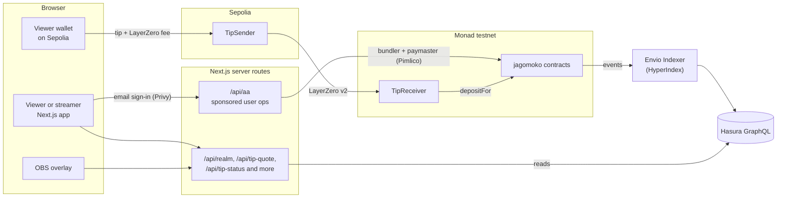

# jagomoko

**A place where streamers get closer to their community.**

Viewers back the streamer's challenges, call the outcome of matches and vote on how the community treasury is spent, while their character levels up with every stream. Every tip splits instantly between the creator and the community, live on stream and on Monad.

| | |
|---|---|
| Demo video (3 min) | TBD |
| Live site | TBD |
| Network | Monad testnet (chain id 10143), plus Ethereum Sepolia as a source chain for cross-chain tips |
| License | [MIT](LICENSE) |

---

## Contents

- [What it does](#what-it-does)
- [How it uses Monad](#how-it-uses-monad)
- [Deployed contracts](#deployed-contracts)
- [Architecture](#architecture)
- [Technology stack](#technology-stack)
- [Repository layout](#repository-layout)
- [Setup](#setup)
- [Deployment](#deployment)
- [Tests](#tests)
- [Testnet only: no real money, no token sale](#testnet-only-no-real-money-no-token-sale)
- [Originality and build window](#originality-and-build-window)
- [Use of AI tools](#use-of-ai-tools)
- [Third-party code and services](#third-party-code-and-services)
- [License](#license)

---

## What it does

Every streamer opens a **guild**. Every viewer who joins gets a soulbound **character** (Knight, Seer, Judge or Bard) that earns XP and levels up as they take part.

- **Tips that split themselves.** A tip is divided the moment it lands: 98% to the creator, 1% to the guild's community treasury and 1% to its community fund (each guild sets its own split, but at least 2% always goes to the community). The split is public and enforced by the `SplitVault` contract.
- **Quests.** The streamer takes on a challenge ("beat the boss without getting hit") and viewers back it. The streamer reports the result, anyone can challenge it during a short window, and a disputed result goes to a small jury of viewers.
- **Battles.** Viewers call the outcome of a match before it ends, with real stakes or with points only.
- **Community treasury.** Members vote (weighted by the square root of their XP) on how the treasury is spent, for example clip bounties and giveaways. The creator can veto during the beta.
- **Clip bounties.** Bards submit clips, the guild votes, and the winner is paid from the bounty.
- **Community Pool (yield).** A guild can vote to put up to half of its treasury to work in a pool that splits it between token staking and liquid staking, and pull it back out instantly when a payout needs it.
- **Tips from another chain.** Viewers can tip with ETH on Sepolia from their own wallet. LayerZero carries the tip to Monad, where it splits like any other tip and shows on stream. A QR code on the stream overlay opens the tip page on a phone.
- **Stream overlay.** An OBS browser source shows tips (with the viewer's message), backings, picks and results live, with the guild's mascots.
- **No crypto friction.** Viewers sign in with an email. Every action is a sponsored ERC-4337 user operation, so nobody needs a wallet or gas.

## How it uses Monad

Everything that holds or moves money, and every vote, lives in contracts on Monad testnet. The web app reads the chain through the Envio Indexer (HyperIndex) and writes to it through sponsored smart-account transactions.

Why Monad fits:

- **Real-time stream moments.** An alert has to appear on stream while the moment is still happening. Monad's sub-second blocks let a tip, a backing or a pick reach the overlay within a few seconds of the viewer pressing the button.
- **Many small actions.** A stream produces lots of $1 tips, votes, picks and XP updates. Monad's throughput and low fees make it practical to put every one of them on chain, and to sponsor the gas for viewers.
- **Full EVM compatibility.** The contracts use OpenZeppelin, ERC-4626 vaults, ERC-4337 smart accounts (Kernel) and LayerZero v2 without changes, and the same tooling (Foundry, viem, Envio Indexer) works out of the box.

What each on-chain piece is for:

| Contract | Purpose |
|---|---|
| `CreatorRegistry` | Guilds: handle, owner, moderators and the tip split (changes are time-locked) |
| `Character` | Soulbound characters with a role, XP and level |
| `SplitVault` | Receives every tip and quest payout, splits it, and holds each guild's creator balance, treasury and community fund |
| `QuestEscrow` | Holds the money behind a challenge until the result is settled |
| `PredictionBattle` | Calls on a match outcome, with stakes or points |
| `OptimisticResolver` / `Jury` | Reported results, the challenge window, and jury votes on disputes |
| `CommunityTreasury` | Proposals and XP-weighted votes: payouts (Spend) and how much of the treasury goes into the Community Pool (Allocate) |
| `ClipBoard` | Clip bounties: submissions, votes, winner payout |
| `CommunityPoolVault` | ERC-4626 pool that is the SplitVault's strategy; splits money between `MockYieldVault` (token staking) and `LstStrategy` (liquid staking) |
| `LstStrategy`, `MokoSwap`, `MockLST`, `MockMON` | The liquid staking leg: mUSD swapped to mMON and staked as stMON, with an instant exit |
| `TipReceiver` | Monad end of cross-chain tips (LayerZero v2 OApp); credits the tip through `SplitVault.depositFor` |
| `TipSender` (Sepolia) | Source end of cross-chain tips: prices ETH with Chainlink, checks limits and sends the tip over LayerZero |
| `MockUSD`, `MockYieldVault` | Testnet practice dollars and a simulated staking vault |

## Deployed contracts

Monad testnet (chain id 10143, start block 68089043). The same list is in [`contracts/deployments/10143.json`](contracts/deployments/10143.json).

| Contract | Address |
|---|---|
| CreatorRegistry | [`0x5F4ef1E644659cE869e8273C57a01b3eef941c0b`](https://testnet.monadscan.com/address/0x5F4ef1E644659cE869e8273C57a01b3eef941c0b) |
| Character | [`0x87843d5F023b8bE8677A46947786e774faB8561f`](https://testnet.monadscan.com/address/0x87843d5F023b8bE8677A46947786e774faB8561f) |
| SplitVault | [`0x3C802933e46ECB281f1a3983b37E4576581dFA9c`](https://testnet.monadscan.com/address/0x3C802933e46ECB281f1a3983b37E4576581dFA9c) |
| QuestEscrow | [`0x82639195476756691Cb9C1293c7043a8713F1339`](https://testnet.monadscan.com/address/0x82639195476756691Cb9C1293c7043a8713F1339) |
| PredictionBattle | [`0xa53AB74a11A0eaAeEF044B550A1385445606CC95`](https://testnet.monadscan.com/address/0xa53AB74a11A0eaAeEF044B550A1385445606CC95) |
| Jury | [`0xc7bA804F8acb6FE2e6C2734394D10D93b8a79A11`](https://testnet.monadscan.com/address/0xc7bA804F8acb6FE2e6C2734394D10D93b8a79A11) |
| CommunityTreasury | [`0xC0f226A4707A0a84c6cD00595409a4ccD7801334`](https://testnet.monadscan.com/address/0xC0f226A4707A0a84c6cD00595409a4ccD7801334) |
| ClipBoard | [`0xF8fc3d288c5CE2f773cAbC979576908B19663f5d`](https://testnet.monadscan.com/address/0xF8fc3d288c5CE2f773cAbC979576908B19663f5d) |
| MockUSD | [`0x287b1F1FC2BA902321D0c11Cc6dBfC729e9D8be0`](https://testnet.monadscan.com/address/0x287b1F1FC2BA902321D0c11Cc6dBfC729e9D8be0) |
| MockYieldVault | [`0x741c30C83B4bFb54595334fc7D6AC2d2dc1E6d79`](https://testnet.monadscan.com/address/0x741c30C83B4bFb54595334fc7D6AC2d2dc1E6d79) |
| CommunityPoolVault | [`0x2E387Ce1B5b2E72d0d293107f52F660eBe867560`](https://testnet.monadscan.com/address/0x2E387Ce1B5b2E72d0d293107f52F660eBe867560) |
| LstStrategy | [`0x14584DF7aC5ea662f9e5f8e8B89FFb51c8d06F06`](https://testnet.monadscan.com/address/0x14584DF7aC5ea662f9e5f8e8B89FFb51c8d06F06) |
| MockLST | [`0xe6b9Feb8b5B0332a4868D60e9073E1425889AC81`](https://testnet.monadscan.com/address/0xe6b9Feb8b5B0332a4868D60e9073E1425889AC81) |
| MockMON | [`0x0a4C0f0f5Ed4B575eBfaf1a9254abadb276d2B86`](https://testnet.monadscan.com/address/0x0a4C0f0f5Ed4B575eBfaf1a9254abadb276d2B86) |
| MokoSwap | [`0xD0c4f4635d34B38843d1d5E119603cB55cA56854`](https://testnet.monadscan.com/address/0xD0c4f4635d34B38843d1d5E119603cB55cA56854) |
| TipReceiver | [`0x271EC27A148D04462449C8F13788695B88Ce4d05`](https://testnet.monadscan.com/address/0x271EC27A148D04462449C8F13788695B88Ce4d05) |

Ethereum Sepolia (chain id 11155111), see [`contracts/deployments/11155111.json`](contracts/deployments/11155111.json).

| Contract | Address |
|---|---|
| TipSender | [`0x13d99ea6c25a7bb1ef50e52A722eD9Fd2Ec7617F`](https://sepolia.etherscan.io/address/0x13d99ea6c25a7bb1ef50e52A722eD9Fd2Ec7617F) |

LayerZero v2 endpoint ids: Monad testnet `40442`, Sepolia `40161`.

## Architecture



- **Writes.** A viewer signs in with an email through Privy. Privy gives them an embedded signer that owns a Kernel smart account. Every action is an ERC-4337 user operation sent through our `/api/aa` proxy, which only allows calls to the jagomoko contracts and adds the Pimlico key, so Pimlico's paymaster pays the gas.
- **Reads.** The Envio Indexer (HyperIndex) turns contract events into guilds, characters, quests, battles, proposals, members and a live activity feed in Postgres, served by Hasura GraphQL. The browser never talks to the indexer directly. Next.js server routes read it, rate-limit the requests and shape the data. The Community Pool's live values are read straight from the chain with a multicall.
- **Overlay.** The OBS browser source polls the guild's activity and turns new events into alerts, quest and battle panels, and the optional tip QR.
- **Cross-chain tips.** On Sepolia, `TipSender` prices the ETH with Chainlink, enforces the allowed assets and the $1 to $100 limits, and sends the tip (creator, donor, amount and message) over LayerZero v2. On Monad, `TipReceiver` mints the practice dollars and deposits them for the donor through `SplitVault.depositFor`. It never reverts, so a failed deposit sends the money back to the donor's own address instead of getting stuck.
- **Community Pool.** The `CommunityPoolVault` is the SplitVault's ERC-4626 strategy. Guilds vote what share of their treasury goes in (at most 50%), and a curator sets how the pool is split between token staking and liquid staking (liquid staking at most 50%). A payout pulls the money back out automatically, idle money first, then token staking, then liquid staking through an instant exit.

## Technology stack

| Layer | Tools |
|---|---|
| Contracts | Solidity 0.8.28, Foundry, OpenZeppelin 5, LayerZero v2 OApp, Chainlink price feeds |
| Indexer | Envio Indexer (HyperIndex v3), Postgres, Hasura GraphQL |
| Web | Next.js 16 (App Router), React 19, TypeScript, Tailwind CSS 4, Radix UI, GSAP |
| Chain access | viem, permissionless, Kernel v0.3.1 smart accounts, Pimlico bundler and paymaster, Privy email sign-in |
| Testing | forge test (including fork tests and LayerZero's TestHelperOz5), Vitest |
| Package manager | Bun |

## Repository layout

```
contracts/   Foundry project: src/ contracts, script/ deploy scripts, test/, deployments/ addresses
indexer/     Envio Indexer (HyperIndex): config.yaml, schema.graphql, src/handlers, test/
web/         Next.js app: src/app routes, src/components, src/lib (chain, data, domain, server ...)
```

## Setup

### Prerequisites

- [Bun](https://bun.sh) 1.2 or newer
- [Foundry](https://book.getfoundry.sh) (forge, cast)
- Node.js 20.9+ for the web app, Node.js 22+ for the indexer
- For the indexer: Linux, macOS or WSL 2 on Windows, plus Docker

### Quick start: the web app with sample data (no keys needed)

```bash
cd web
bun install
cp .env.example .env    # NEXT_PUBLIC_SAMPLE_DATA=true by default
bun run dev             # http://localhost:3000
```

Every screen renders clearly labelled sample data, so you can click through guilds, quests, battles, the treasury, the studio and the overlay (`/overlay/neonblade`).

### Contracts

```bash
cd contracts
git submodule update --init --recursive   # forge-std, openzeppelin-contracts
bun install                               # LayerZero packages from npm
forge build
forge test
```

### Indexer

```bash
cd indexer
bun install
cp .env.example .env          # add your ENVIO_API_TOKEN (https://envio.dev/app/api-tokens)
bun run sync:deployment       # copies the addresses from contracts/deployments/10143.json
bun run dev                   # Linux/macOS; on Windows use: bun run dev:wsl
```

GraphQL is served at `http://localhost:8080/v1/graphql` (local dev admin secret `testing`). After a schema change, start it with `-r` to re-index from scratch, for example `bun run dev:wsl -r`.

### Web app with live data and real transactions

In `web/.env`:

- `NEXT_PUBLIC_SAMPLE_DATA=false` and `INDEXER_GRAPHQL_URL` / `INDEXER_GRAPHQL_SECRET` to read the indexer
- `NEXT_PUBLIC_CHAIN_MODE=true` with `NEXT_PUBLIC_PRIVY_APP_ID`, `PRIVY_APP_SECRET` and `PIMLICO_API_KEY` for email sign-in and sponsored gas
- optional `MONAD_RPC_URL`, `SEPOLIA_RPC_URL`, and `NEXT_PUBLIC_SITE_URL` (the public address the overlay's tip QR points to)

Every variable is explained in [`web/.env.example`](web/.env.example). Then:

```bash
cd web
bun run sync:deployment   # writes src/lib/chain/deployment.json from contracts/deployments
bun run dev
```

## Deployment

Contracts are deployed with Foundry scripts. Each one is a dry run without `--broadcast`, and records the new addresses in `contracts/deployments/<chainId>.json` only when it broadcasts.

A fresh deployment takes three steps:

```bash
cd contracts
export PRIVATE_KEY=0x...   # the deployer
```

```bash
LZ_ENDPOINT=0x3aCAAf60502791D199a5a5F0B173D78229eBFe32 DEMO_MODE=true forge script script/Deploy.s.sol --rpc-url monad_testnet --broadcast
```

```bash
forge script script/DeployTipSender.s.sol --rpc-url sepolia --broadcast
```

```bash
forge script script/SetTipPeer.s.sol --rpc-url monad_testnet --broadcast
```

1. `Deploy.s.sol` deploys every Monad contract (guilds, characters, vault, quests, battles, jury, treasury, clip bounties, the Community Pool and, with `LZ_ENDPOINT`, the TipReceiver). `DEMO_MODE=true` uses short demo timings, a 2 minute challenge window and a 5 minute jury vote (the treasury vote stays 24 hours). Leave it off for a real deployment.
2. `DeployTipSender.s.sol` deploys the TipSender on Sepolia (the deployer needs a little Sepolia ETH) and points it at the TipReceiver.
3. `SetTipPeer.s.sol` lets the TipReceiver accept messages from that TipSender.

The live testnet deployment was built in stages, so it also has two upgrade scripts that add contracts to an existing deployment without touching the rest: `DeployClipBoard.s.sol` (clip bounties) and `DeployV2.s.sol` (the Community Pool and TipReceiver, with an optional `CURATOR` address).

Then run `bun run sync:deployment` in `web/` and in `indexer/`, and restart the indexer with `-r`. The web app is a standard Next.js app (`bun run build`, `bun run start`) and can be hosted on any Node.js host, such as Vercel.

## Tests

```bash
cd contracts && forge test                                                  # unit, fuzz and LayerZero tests
cd contracts && FORK_TESTS=true forge test --match-path test/ForkV2.t.sol   # against live Monad testnet and Sepolia
cd indexer && bun run test                                                  # handler tests (Linux/WSL)
cd web && bun run typecheck && bun run test
```

## Testnet only: no real money, no token sale

jagomoko runs on testnets only. mUSD ("practice dollars"), mMON, stMON, the MokoSwap price and the pool's yield are all mock contracts with no monetary value, made to show how the product works. There is no token sale, no liquidity, and no trading. On mainnet, the mocks would be replaced by a real stablecoin, a real DEX and a real liquid staking protocol.

## Originality and build window

All code in this repository was written during the hackathon. The first commit is from 2026-10-01, and the commit history covers the whole build window. No pre-existing jagomoko code or product was used as a foundation. The only code from outside the project is the open source libraries listed under [Third-party code and services](#third-party-code-and-services).

## Use of AI tools

AI tools were used to build jagomoko, as the rules allow:

- **Claude Code (Anthropic)** was used as a coding assistant throughout the project, to write and test much of the smart contracts, indexer, web app and deploy scripts, to check the deployed contracts, and to build the Figma designs. All product decisions, reviews, deployments and the final call on every change were made by the team.
- **Nano Banana Pro (Google Gemini)** was used to generate the mascot, scene and logo artwork in `web/public`.

## Third-party code and services

Libraries (each under its own license, see the package or repository):

| Library | Used for |
|---|---|
| [OpenZeppelin Contracts](https://github.com/OpenZeppelin/openzeppelin-contracts) | ERC-20, ERC-721, ERC-4626, AccessControl, ReentrancyGuard, SafeERC20 |
| [forge-std](https://github.com/foundry-rs/forge-std) | Foundry tests and scripts |
| [LayerZero v2](https://github.com/LayerZero-Labs/LayerZero-v2) (`@layerzerolabs/oapp-evm`, `lz-evm-protocol-v2`, `lz-evm-messagelib-v2`, `lz-evm-v1-0.7`, `oft-evm`, `test-devtools-evm-foundry`) | Cross-chain tips (OApp) and their tests |
| [solidity-bytes-utils](https://github.com/GNSPS/solidity-bytes-utils) | Required by the LayerZero packages |
| [Envio Indexer (HyperIndex)](https://envio.dev) | Turns contract events into the app's data |
| [viem](https://viem.sh) | Chain reads and writes |
| [permissionless](https://docs.pimlico.io/permissionless) | Kernel smart accounts and user operations |
| [Privy](https://privy.io) (`@privy-io/react-auth`, `@privy-io/node`) | Email sign-in and embedded signers |
| [Next.js](https://nextjs.org), [React](https://react.dev) | Web app |
| [Tailwind CSS](https://tailwindcss.com), [Radix UI](https://www.radix-ui.com), class-variance-authority, clsx, tailwind-merge | UI |
| [GSAP](https://gsap.com) | Landing page motion |
| [lucide-react](https://lucide.dev), [simple-icons](https://simpleicons.org) | Icons |
| [Geist](https://vercel.com/font) | Typeface |
| [uqr](https://github.com/unjs/uqr) | QR code on the stream overlay |
| [zod](https://zod.dev) | Input validation |
| [sharp](https://sharp.pixelplumbing.com) | Image processing for the mascot assets |
| [Vitest](https://vitest.dev), [TypeScript](https://www.typescriptlang.org) | Tests and types |

Services and on-chain infrastructure:

- [Monad testnet](https://monad.xyz) and its public RPC
- [Pimlico](https://pimlico.io) bundler and paymaster (sponsored gas)
- [Privy](https://privy.io) authentication
- [LayerZero v2](https://layerzero.network) endpoints and DVN
- [Chainlink](https://chain.link) ETH/USD price feed on Sepolia
- [Envio Indexer (HyperIndex)](https://envio.dev) and a QuickNode RPC for indexing

## License

[MIT](LICENSE)
